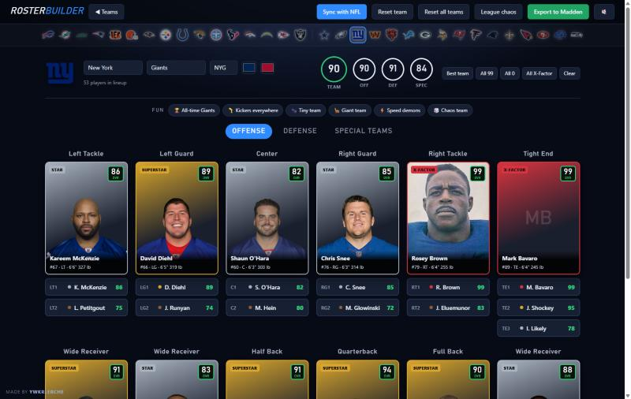
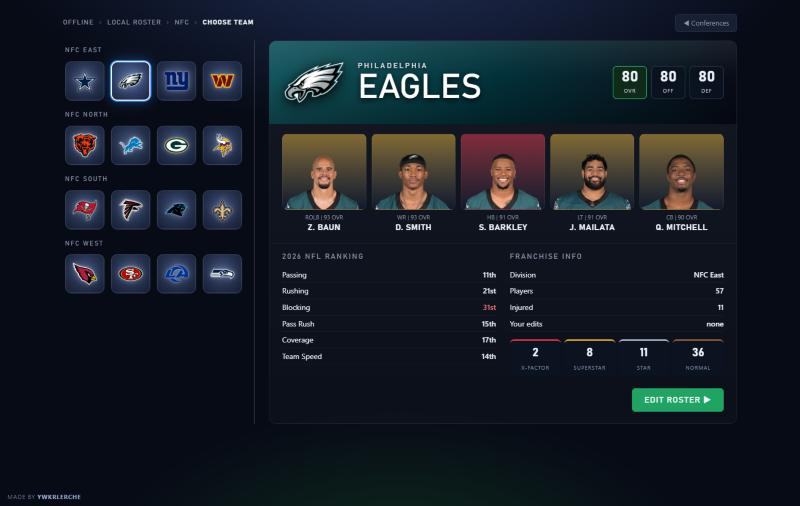
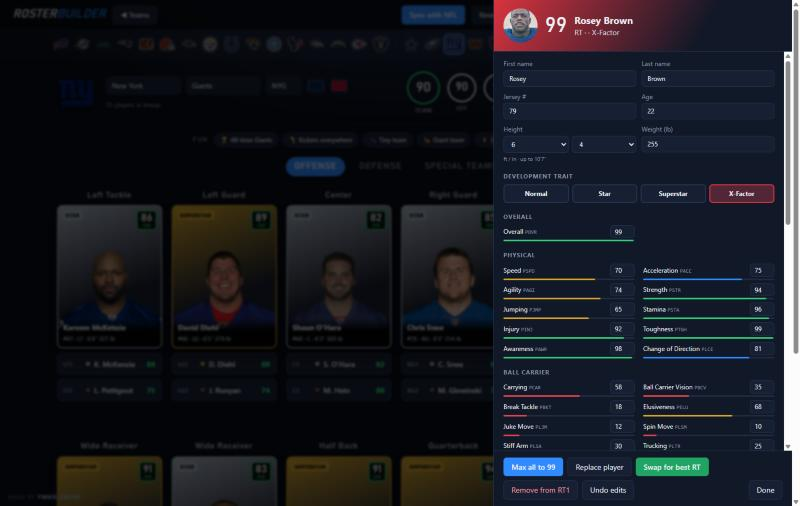

# Madden 27 Roster Builder

**Made by ywkrlerche**

[](https://github.com/Kingston5390/madden27-roster-builder/releases/latest/download/RosterBuilder.exe)
[](https://github.com/Kingston5390/madden27-roster-builder/releases/latest)

A free desktop app for building and editing **Madden NFL 27** rosters on PC. Pick any team, drop any player in the league into any slot, change ratings, height, weight and development trait, pull in all-time legends, sync with the real NFL, and export a roster file Madden loads like any other.



## Screenshots

| Choose a conference | Choose a team |
|---|---|
|  |  |

| Edit any player |
|---|
|  |

## What it does

**Build a lineup**
- AFC / NFC and Madden-style team select with team ratings, top players, NFL rankings and development-trait counts.
- Lineup board for offense, defense and special teams with depth slots (LT1, LT2, WR1…WR5 and so on). The team's real depth chart loads first.
- Click **+** on any slot to search all ~3,100 players by name, position or team, or take the **best available** player at that position.
- Real player headshots, and all 32 team logos across the top to jump between teams.

**Edit players**
- Every rating (0–99), overall, height (up to 10'7", body size included), weight, age, jersey number, name, and development trait (Normal, Star, Superstar, X-Factor).
- Max all to 99, swap for the best player at a position, replace or remove.

**Quick buttons**
- Best team, All 99, All 0, All X-Factor, Clear.
- Fun: **All-time [team]** (that franchise's legends), Kickers everywhere, Tiny team (5'0"), Giant team (10'0"), Speed demons, Chaos team.
- League chaos: **Randomize NFL teams** (every player dealt to a random team) and **Randomize positions**.

**Keep it real**
- **Sync with NFL** pulls every team's current roster and the latest injury report, then writes an updated copy of your roster: trades, signings and injuries (weeks out from the estimated return date). Practice-squad players are skipped and no team goes over 75.

**Export**
- Writes a **new** roster file to your Madden saves folder. It never overwrites a roster. Load it in Madden from your saved rosters.
- Madden shows a roster by the text after the last dash in its file name, so export names are letters and digits only (for example `ROSTER-NewYorkGiants`).

Also: sound effects (with a mute button), animations and a loading screen.

## Download and run

1. [Download `RosterBuilder.exe`](https://github.com/Kingston5390/madden27-roster-builder/releases/latest/download/RosterBuilder.exe) (always the latest version, also on the [Releases](../../releases) page).
2. Double-click it. It finds your saves folder (`Documents\Madden NFL 27\saves`) and opens in its own window. A small console window stays open; close it to quit.

Player photos, team logos and NFL sync need an internet connection. Building, editing and exporting work offline.

### Legends
The All-time team button and legend search read legends from any roster in your saves folder with **"Legends"** in its name (for example a community legends roster). Legends are copied into your export with their face models. Photos for legends come from ESPN or Wikipedia.

## Security & verification

**Scan result (v1.0.0):** Microsoft Defender Antivirus, engine 1.1.26100.4, signatures 1.463.110.0 (Nov 3, 2026), custom scan of `RosterBuilder.exe`: **no threats found**.

**SHA-256 (v1.0.0):** `cd5f2a50a9f19f491ce125517a7dff1eaee2376b146e11817e7fb7e97b512958`

Check your download matches, in PowerShell:

```powershell
Get-FileHash .\RosterBuilder.exe -Algorithm SHA256
```

**What the exe contains:** the official **Node.js** runtime with this repository's code bundled inside ([Node single executable application](https://nodejs.org/api/single-executable-applications.html)). You can build the same thing from source (below).

**What it does on your PC:**
- Runs a local web server on `127.0.0.1` (not reachable from other computers) and opens the UI in a browser window.
- Reads roster files in your Madden saves folder and writes **new** roster files there. It doesn't modify existing rosters or any game files.
- Connects only to ESPN (rosters, injuries, headshots, logos) and Wikipedia (legend photos).

The exe isn't code-signed, so Windows SmartScreen may show "Windows protected your PC" on first run. Choose **More info → Run anyway**.

## Build from source

Requires [Node.js](https://nodejs.org) 24.

```bash
git clone https://github.com/Kingston5390/madden27-roster-builder.git
cd madden27-roster-builder
node server.js        # run without building: opens the app
node build.js         # builds dist/RosterBuilder.exe
```

`node server.js --saves "D:\path\to\saves"` points it at a different saves folder.

## How it works

Madden 27 roster files are an `FBCHUNKS` container holding one zlib-compressed EA **TDB2** document: tables of tagged records (`PLAY` players, `TEAM`, `DCHT` depth chart, `INJY` injuries, `BLOB` per-player appearance, and more). Tags are 3 bytes packing four 6-bit characters, and integers are variable-length with a sign bit. The header stores the payload size and a **CRC-32/BZIP2** of the payload, which the game checks.

- `lib/tdb2.js` reads and writes the format byte-for-byte (re-encoding an unedited roster gives identical bytes).
- `lib/roster.js` turns a lineup and edits into a new roster: moves players, rebuilds depth charts, fixes jersey clashes, and keeps each player's appearance data (height, weight, name, number) in sync with his ratings record.
- `lib/sync.js` maps ESPN rosters and injury reports onto the file.
- `lib/league.js` does the league-wide shuffles.
- `lib/photos.js` finds legend photos.
- `ui/index.html` is the whole interface.

## Known limits

- **Abilities** aren't stored in roster files, so they can't be edited here. Use Madden's own editor.
- In **Franchise**, Madden keeps players it rates as Normal at Normal even if the roster says X-Factor.
- A few rating codes (`PLIB`, `PSTM`) aren't identified yet. Every rating shows its code.

## Credits and disclaimer

Made by **ywkrlerche**.

Unofficial fan tool, not affiliated with or endorsed by Electronic Arts, the NFL or ESPN. Madden NFL is a trademark of Electronic Arts. Team logos, player photos, rosters and injury data are loaded at runtime from ESPN (and Wikipedia for legend photos) and are not included in this repository.

Released under the [MIT License](LICENSE).
