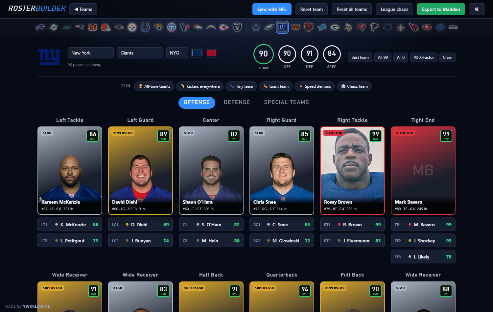
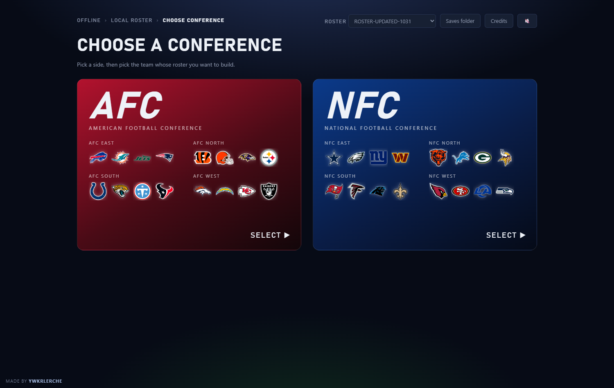
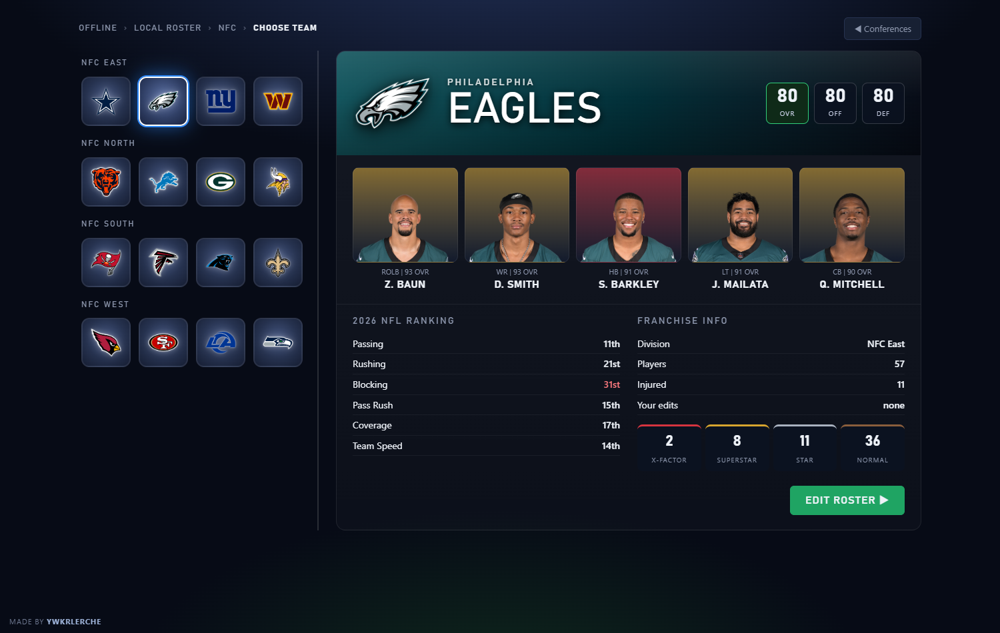
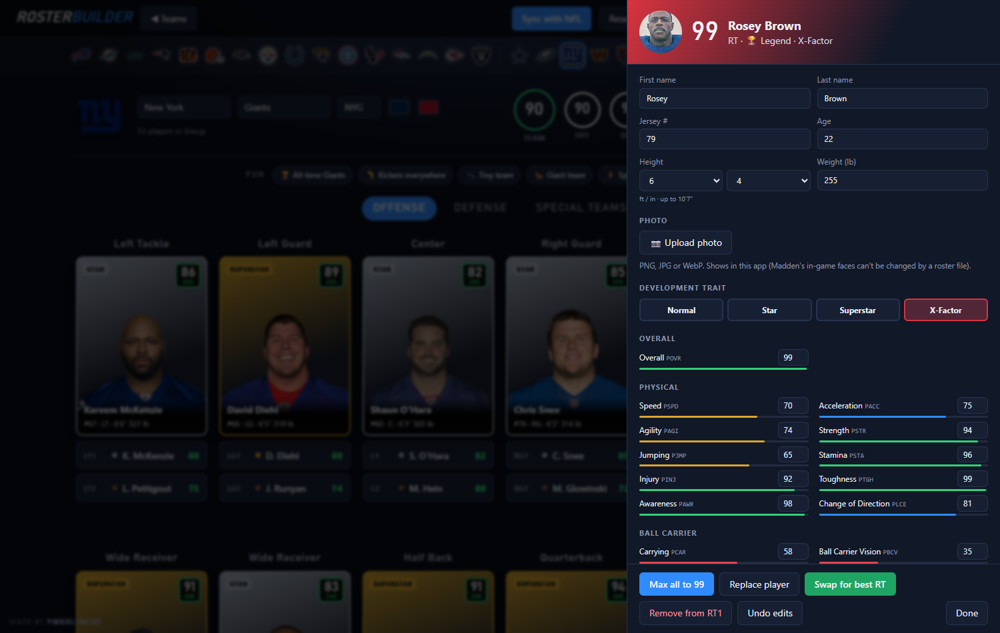
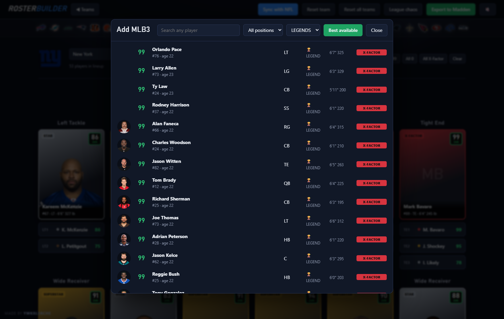
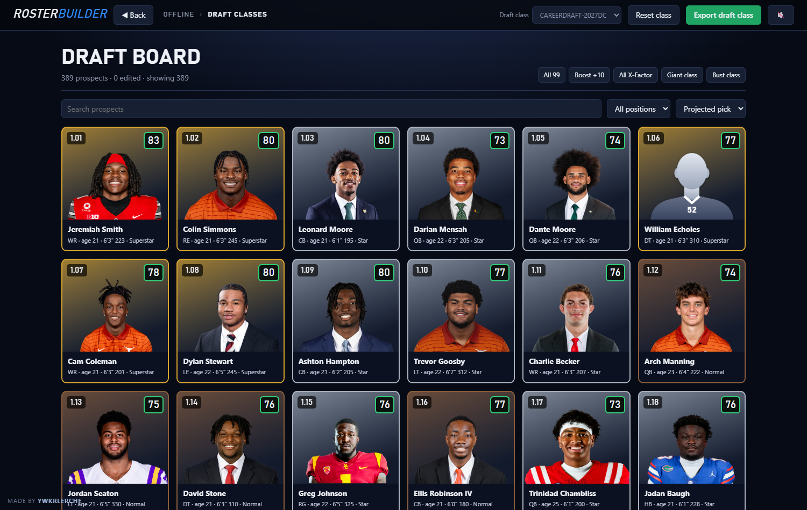
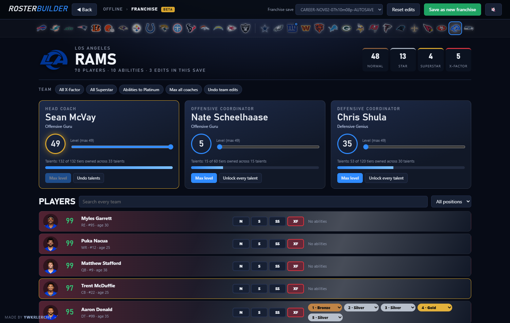
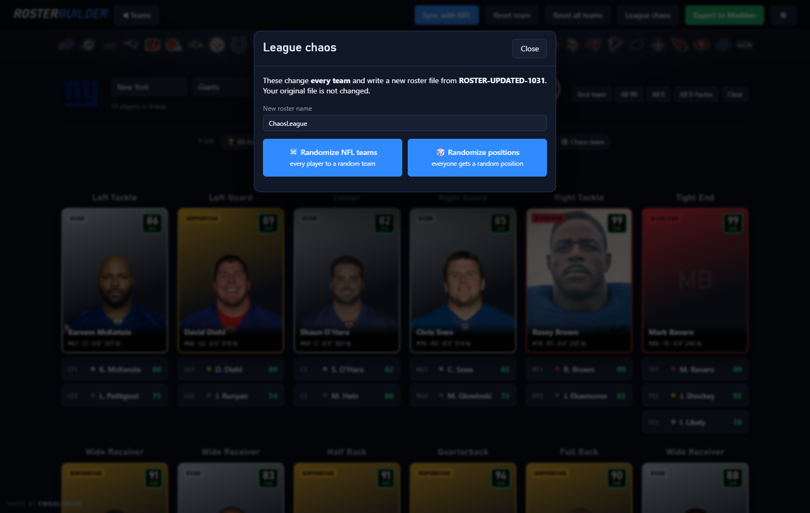

# Madden 27 Roster Builder

**Made by ywkrlerche**

[](https://github.com/Kingston5390/madden27-roster-builder/releases/latest/download/RosterBuilder.exe)
[](https://github.com/Kingston5390/madden27-roster-builder/releases/latest)

A free desktop app for editing **Madden NFL 27** rosters, draft classes and franchise saves on PC. Pick any team, drop any player in the league into any slot, change ratings, height, weight and development trait, pull in all-time legends, sync with the real NFL, rework a draft class, max out your coach, and export files Madden loads like any other.



## Screenshots

| Choose a conference | Choose a team |
|---|---|
|  |  |

| Edit any player (and upload a photo) | Add anyone, including legends |
|---|---|
|  |  |

| Draft classes | Franchise saves (beta) |
|---|---|
|  |  |

| League chaos |
|---|
|  |

## What it does

**Build a lineup**
- AFC / NFC and Madden-style team select with team ratings, top players, NFL rankings and development-trait counts.
- Lineup board for offense, defense and special teams with depth slots (LT1, LT2, WR1…WR5 and so on). The team's real depth chart loads first.
- **Full depth chart** for every position: add players without replacing anyone, reorder, remove, or add the best available.
- Click **+** on any slot to search all ~3,100 players by name, position or team, or take the **best available** player at that position. Typing a name searches every position, so any player, legends included, can play anywhere.
- All 32 team logos across the top to jump between teams, and a Roster picker to switch roster files without leaving the team.

**A headshot for every player**
- Current players use their ESPN headshot. Anyone ESPN's rosters don't cover (legends, free agents, renamed players, franchise rookies) is looked up once by name on ESPN, then Wikipedia.
- Anyone with no photo anywhere, or whose photo won't load (for example offline), gets a silhouette in his team's colors with his jersey number. Your own uploads always come first.

**Edit players**
- Every rating (0–99), overall, height (up to 10'7", body size included), weight, age, jersey number, name, and development trait (Normal, Star, Superstar, X-Factor). Every rating has a slider and a number box.
- **Spreadsheets**: save a team (or a draft class) as a CSV, edit it in Excel or Google Sheets, and import it back.
- Max all to 99, swap for the best player at a position, replace or remove.
- **Upload your own photo** for any player (PNG, JPG or WebP), great for custom players. Photos are saved on your PC and show on cards, in search and in the editor. They appear in this app only: Madden's in-game faces are 3D head models a roster file can't replace.

**Quick buttons**
- Best team, All 99, All 0, All X-Factor, Clear.
- Fun: **All-time [team]** (that franchise's legends), Kickers everywhere, Tiny team (5'0"), Giant team (10'0"), Speed demons, Chaos team.
- League chaos: **Randomize NFL teams** (every player dealt to a random team) and **Randomize positions**.

**Trades** (Madden style)
- Pick any two teams, add players to each side, and watch the trade interest meter. CPU teams judge value (overall, age, position, dev trait) and their team needs, and can decline. **Force accept** pushes any trade through.
- **Get offers**: put players on the block and CPU teams make real offers from their rosters.
- Accepted trades are saved to a new roster file when you're ready.

**Keep it real**
- **Sync with NFL** pulls every team's current roster and the latest injury report, then writes an updated copy of your roster: trades, signings and injuries (weeks out from the estimated return date). Practice-squad players are skipped and no team goes over 75. It never changes the roster you're on: you choose whether to open the synced copy.

**Export**
- Writes a **new** roster file to your Madden saves folder. It never overwrites a roster. Load it in Madden from your saved rosters.
- Madden shows a roster by the text after the last dash in its file name, so export names are letters and digits only (for example `ROSTER-NewYorkGiants`).

**Draft classes** (`CAREERDRAFT-` files)
- A draft board for any class in your saves folder, with college headshots, sorted by projected pick (1.01, 1.02…), plus search and a position filter.
- Edit any prospect: name, position, college, hometown, age, height, weight, jersey, projected round and pick, overall, development trait and all 55 ratings. Upload a photo for anyone.
- **New prospect**: search ESPN for any real college player and add him with his real name, school, position, height, weight, hometown and headshot, or make up your own player. Either way you set every rating. New players fill the class's empty slots (Madden's classes have room for 455, and EA's use 389).
- Quick buttons for the prospects shown: All 99, Boost +10, All X-Factor, Giant class (10'0"), Bust class.
- Exports a new `CAREERDRAFT-` file to import in Franchise.

**Franchise saves** (`CAREER-` files, beta)
- Opens any franchise save on the team you coach, with all 32 teams one click away.
- **Development traits** that stick in Franchise: Normal, Star, Superstar or X-Factor for any player, or the whole team at once.
- **Ability ranks**: Bronze, Silver, Gold or Platinum for each ability a player has.
- **Contracts**: years left and salary per year for any player.
- **Start at a real week**: pick a week of the current NFL season and get a new save with every real result before it. Either sim to that week in Madden (Madden plays each game with its real winner) or open the save already at that week with real scores, records and standings written in (experimental; needs a save from the regular season).
- **Coaches**: raise your head coach and coordinators to level 49 and unlock every talent tier. Vacant jobs are shown as vacant.
- Saves a new `CAREER-` file, then reads it back to check every change. Load it in Madden from Franchise → Load.

**Look and sound**
- Tells you when a new version is out, with a download button.
- A different intro every launch (five originals), and your own `.mp4` or `.webm` clips join the rotation: drop them in `%APPDATA%\RosterBuilder\intros` (Credits → Open intros folder).
- Sound effects with a mute button, animations and a loading screen.

## Download and run

1. [Download `RosterBuilder.exe`](https://github.com/Kingston5390/madden27-roster-builder/releases/latest/download/RosterBuilder.exe) (always the latest version, also on the [Releases](../../releases) page).
2. Double-click it. It finds your saves folder (`Documents\Madden NFL 27\saves`, including when OneDrive moved Documents) and opens in its own window (Chrome if you have it, otherwise Edge; you can also paste the address shown in the console into any browser). Close the app window to quit. There's no console window; if something goes wrong, the details are in `%APPDATA%\RosterBuilder\log.txt`.

If it says no roster files were found, save a roster in Madden first, or click **Choose saves folder**: it lists every Madden saves folder it finds on your PC, or browse to yours. The app remembers it.

Player photos, team logos and NFL sync need an internet connection. Building, editing and exporting work offline.

### Legends
The All-time team button and legend search read legends from any roster in your saves folder with **"Legends"** in its name (for example a community legends roster). Legends are copied into your export with their face models and Madden 27's own in-game headshot when the game has one (about 680 legends do; some, like Ben Roethlisberger, have none in Madden 27). Every export also repairs players whose headshot id the game doesn't have. Photos for legends in the app come from ESPN or Wikipedia.

## Security & verification

**Scan result (v1.2.7):** Microsoft Defender Antivirus, engine 1.1.26100.4, signatures 1.463.300.0, custom scan of `RosterBuilder.exe`: **no threats found**.

**SHA-256 (v1.2.7):** `c66a7cee3c03a02c2c90188e5a910eccd01c340ff47b88915558b582c55c8311`

Each release lists its own scan result and checksum.

Check your download matches, in PowerShell:

```powershell
Get-FileHash .\RosterBuilder.exe -Algorithm SHA256
```

**What the exe contains:** the official **Node.js** runtime with this repository's code bundled inside ([Node single executable application](https://nodejs.org/api/single-executable-applications.html)). You can build the same thing from source (below).

**What it does on your PC:**
- Runs a local web server on `127.0.0.1` (not reachable from other computers) and opens the UI in an Edge app window with its own profile.
- Reads rosters, draft classes and franchise saves in your Madden saves folder and writes **new** files there. It doesn't modify existing saves or any game files.
- Keeps its own files in `%APPDATA%\RosterBuilder`: photos you upload, cached photo lookups, your intro clips, the Edge profile, and the franchise save library, which it unpacks there the first time you open a franchise.
- Connects only to ESPN (rosters, injuries, headshots, logos) and Wikipedia (photos for players ESPN doesn't have).

The exe isn't code-signed, so Windows SmartScreen may show "Windows protected your PC" on first run. Choose **More info → Run anyway**.

## Build from source

Requires [Node.js](https://nodejs.org) 24.

```bash
git clone https://github.com/Kingston5390/madden27-roster-builder.git
cd madden27-roster-builder
npm install           # the franchise save library
node server.js        # run without building: opens the app
node build.js         # builds dist/RosterBuilder.exe
```

`node server.js --saves "D:\path\to\saves"` points it at a different saves folder.

The build removes Node's own signature (packing the app in breaks it), so the exe comes out unsigned. To sign it with your own code-signing certificate, set `SIGN_PFX` and `SIGN_PFX_PASSWORD` (a .pfx file) or `SIGN_THUMBPRINT` (a certificate in your Windows certificate store) before `node build.js`.

## How it works

Madden 27 roster files are an `FBCHUNKS` container holding one zlib-compressed EA **TDB2** document: tables of tagged records (`PLAY` players, `TEAM`, `DCHT` depth chart, `INJY` injuries, `BLOB` per-player appearance, and more). Tags are 3 bytes packing four 6-bit characters, and integers are variable-length with a sign bit. The header stores the payload size and a **CRC-32/BZIP2** of the payload, which the game checks.

- `lib/tdb2.js` reads and writes the format byte-for-byte (re-encoding an unedited roster gives identical bytes).
- `lib/roster.js` turns a lineup and edits into a new roster: moves players, rebuilds depth charts, fixes jersey clashes, and keeps each player's appearance data (height, weight, name, number) in sync with his ratings record.
- `lib/sync.js` maps ESPN rosters and injury reports onto the file.
- `lib/league.js` does the league-wide shuffles.
- `lib/photos.js` finds photos for players ESPN's rosters don't cover.
- `lib/draft.js` reads and writes draft classes: a short header, then one fixed-size record per prospect (5,876 bytes) holding a look (generic head, skin tone, gear), names, hometown, college, physicals, projected round and pick, development trait and one byte per rating. Edits patch those bytes in a copy. A created prospect goes in an empty slot as a copy of a real prospect at his position (for a valid look and archetype), with your fields on top and the prospect count raised.
- `lib/college.js` finds real college players on ESPN. `lib/colleges.json` names Madden's college numbers; `tools/build-colleges.js` builds it by matching roster players and draft prospects to ESPN, which lists each player's school.
- `lib/franchise.js` edits franchise saves through the [madden-franchise](https://github.com/bep713/madden-franchise) library, which knows the Madden 27 save schema. A team's staff comes from its head coach and coordinator fields; coach talents are followed down to each tier.
- `ui/index.html` is the whole interface.

## Known limits

- **Abilities**: roster files don't store them. In franchise saves you can change the rank of abilities a player already has, but not add or remove abilities yet. Madden keeps ability and coach talent names in its game files, not in the save, so abilities show by number.
- Roster files can't make an X-Factor stick in an existing **franchise**: Madden keeps players it rates as Normal at Normal. Use the Franchise editor to change dev traits in the save itself.
- **Created prospects** (beta) wear a generic face and gear borrowed from a prospect at the same position, and the announcer won't say a made-up name. A class with more than EA's 389 prospects hasn't been confirmed in Madden yet. If one won't load, edit an existing prospect into your player instead.
- College names cover the 245 schools that NFL players and current prospects come from. Any other school shows as a number.
- A couple of rating codes (`PIMP`, `PSTM`) aren't identified yet. Every rating shows its code.

## Credits and disclaimer

Made by **ywkrlerche**.

Franchise saves are read and written with [madden-franchise](https://github.com/bep713/madden-franchise) by bep713 (MIT). The draft class layout was cross-checked against the Madden modding community's research. Full license texts: [THIRD-PARTY-NOTICES.md](THIRD-PARTY-NOTICES.md).

Unofficial fan tool, not affiliated with or endorsed by Electronic Arts, the NFL or ESPN. Madden NFL is a trademark of Electronic Arts. Team logos, player photos, rosters and injury data are loaded at runtime from ESPN (and Wikipedia for players ESPN doesn't have) and are not included in this repository.

Released under the [MIT License](LICENSE).
